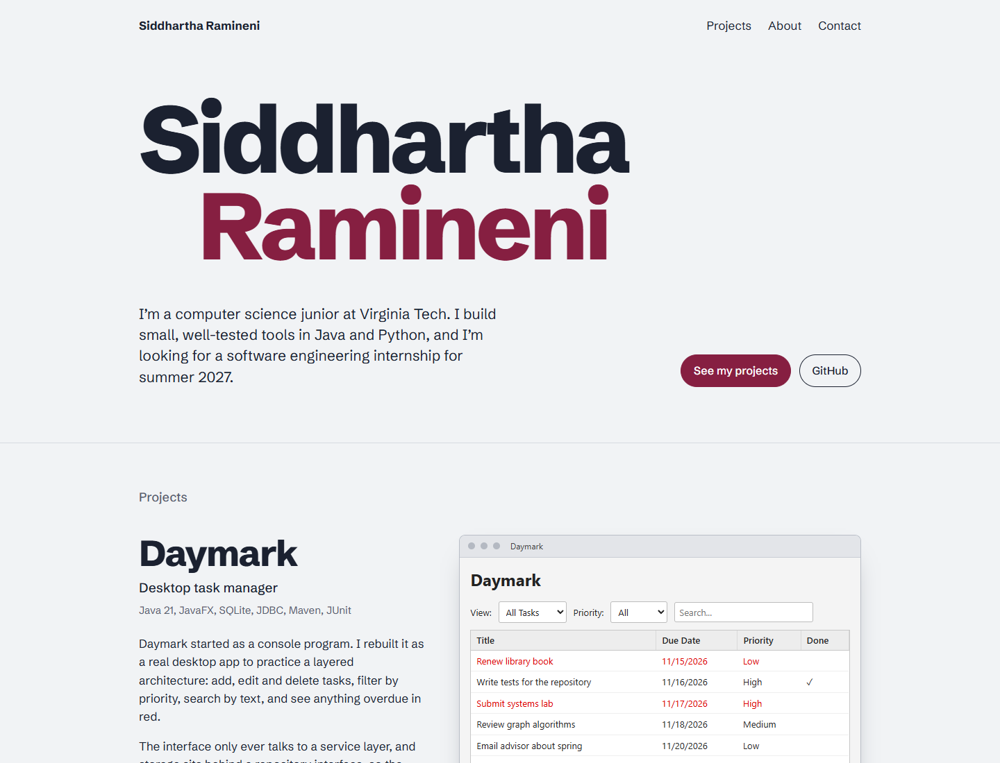

# Siddhartha Ramineni | Software portfolio

<!-- portfolio:start -->

I’m a computer science junior at Virginia Tech. I build small, well-tested tools in Java and Python, and I’m looking for a software engineering internship for summer 2027.



## Featured projects

- [Daymark](https://github.com/Siddhartha231/Daymark) — Desktop task manager. Built with Java 21, JavaFX, SQLite, JDBC, Maven, JUnit.
- [FocusLog](https://github.com/Siddhartha231/Focus-Log) — Command-line Pomodoro tracker. Built with Python, SQLite, argparse.

<!-- portfolio:end -->

## Run locally

Open `index.html` in a browser, or run the following command from the repository and visit [localhost:8000](http://localhost:8000).

```sh
python -m http.server 8000
```

## Keeping the portfolio current

Edit the introduction, featured project cards and demos in `index.html`. Each push to `main` runs the [portfolio refresh workflow](.github/workflows/portfolio.yml). It saves the current list of additional public projects into the page, reads the introduction and featured projects for this README, and captures a desktop screenshot. It commits the generated files when they change. You can also run it from the repository’s Actions tab.

The website refreshes its additional projects from GitHub when a visitor opens the page. If GitHub is unavailable, it displays the saved list. The text outside the generated section of this README can be edited directly.
